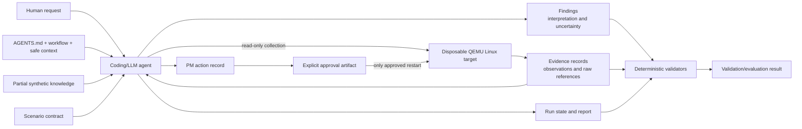

# Infera architecture

Infera is an agent-driven experiment. The coding/LLM agent is deliberately a runtime component: it reads the repository contracts, chooses bounded probes, interprets observations, and writes structured artifacts. The coding/LLM agent performs investigation and reasoning. Deterministic validators check artifact structure, references, safety rules, and scenario expectations.

The human supplies the diagnostic request and, for the PM experiment, the explicit approval. Repository instructions define the safe operating boundary. The agent may inspect the synthetic VM through SSH, and diagnostic workflows are read-only. Scenario injectors are experiment setup tools; agent remediation remains separate.

The QEMU lab provisions a synthetic Ubuntu host with `demo-db.service`, `demo-upstream.service`, and `demo-api.service`. It uses a pinned cloud image, an immutable base-image cache, disposable qcow2 overlays, cloud-init, localhost SSH forwarding, and reset scripts. Scenario-specific setup changes only the disposable overlay.

Knowledge contains partial prior context such as expected services, relationships, and operational patterns. It is not evidence and cannot override contradictory observations. Evidence records describe observed or unavailable probes. Findings express interpretation and must link claims to evidence or preserve them as hypotheses/unknowns. Reports reference those artifacts instead of embedding raw command output.

The PM path has a separate approval boundary. The current public experiment allows one action, restarting `demo-api.service`. An action must have an explicit approval matching its run, action ID, and target before execution; post-action evidence is required before it can be verified.

## Implemented

- declarative scenario and knowledge contracts;
- structured evidence, finding, run-state, action, approval, and report contracts;
- five live diagnostic scenario injectors/verifiers;
- one approval-gated PM workflow;
- disposable QEMU/KVM synthetic Linux lab;
- deterministic structural validators and scenario evaluators;
- reviewed synthetic example runs;
- local CI-equivalent validation, GitHub Actions definitions, and release-manifest generation.

## Deliberately outside the current runtime

- model/provider API integration;
- an automatic live-run manager;
- a deterministic diagnosis engine;
- automatic knowledge promotion;
- broad platform support or multi-host networking;
- hosted GitHub execution until a public repository and suitable runner are configured.

The current scope and non-goals are documented in [`docs/limitations.md`](limitations.md).
